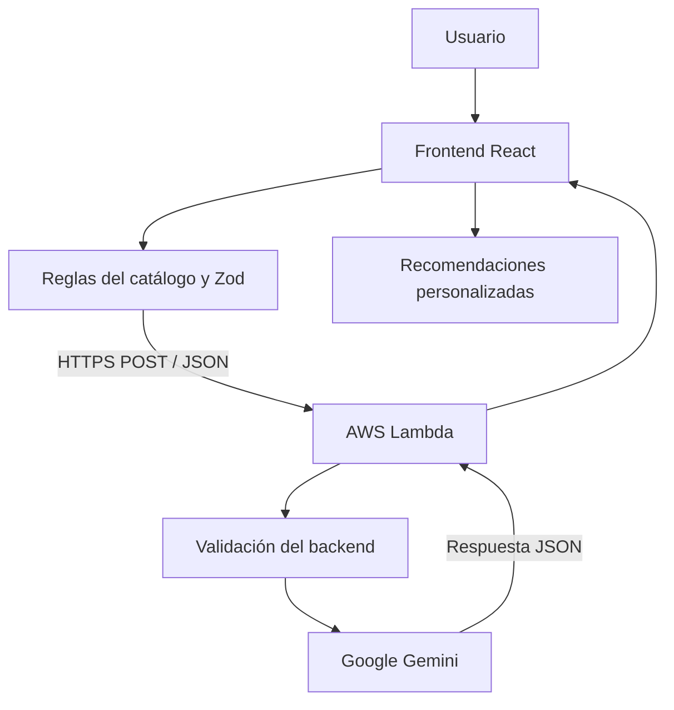
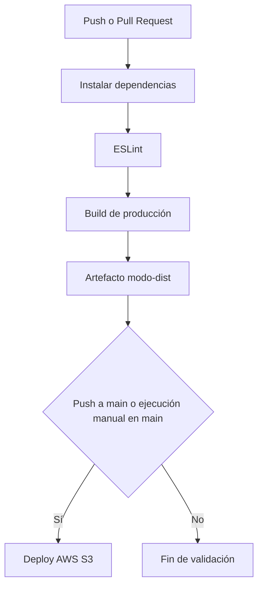

# MODO · Experiencias en Quito | v3.0

Proyecto académico del bootcamp Full Stack — AI Integration & Cloud Deployment.

MODO es una aplicación web que permite descubrir, explorar y consultar experiencias en el Distrito Metropolitano de Quito. Su versión 3.0 incorpora un recomendador inteligente que utiliza Google Gemini para ofrecer experiencias personalizadas según los intereses, el presupuesto y la zona de preferencia del usuario.

## 1. Instalación y ejecución local

### Requisitos

- Node.js >= 22.22.0.
- npm.
- pnpm 11.17.0.
- Git.

### Instalación

Clonar el repositorio:

```bash
git clone https://github.com/crisago11/MODO-proyecto-react.git
cd MODO-proyecto-react
```

Instalar pnpm, si no está disponible:

```bash
npm install -g pnpm@11.17.0
```

Instalar las dependencias:

```bash
pnpm install --frozen-lockfile
```

Iniciar el servidor de desarrollo:

```bash
pnpm run dev
```

La aplicación estará disponible en:

http://localhost:5173

### Validación y compilación

```bash
pnpm run lint:eslint
pnpm run build
```

El build de producción se genera en la carpeta `dist/`.

Para visualizar la compilación localmente:

```bash
pnpm run preview
```

## 2. Configuración

### Variables de entorno

Crear un archivo `.env.local` a partir de `.env.example`:

```bash
cp .env.example .env.local
```

Configurar la siguiente variable:

```dotenv
VITE_MODO_AI_API_URL=
```

El valor debe corresponder a la Function URL HTTPS del backend desplegado en AWS Lambda.

Reiniciar el servidor de desarrollo después de modificar las variables de entorno.

La URL del backend es una configuración pública. El frontend no contiene claves privadas de Google Gemini ni credenciales de AWS.

### Configuración del backend

El backend de MODO AI está implementado en:

`backend/modo-ai/index.mjs`

Se ejecuta en AWS Lambda y utiliza las siguientes variables de entorno:

| Variable | Propósito |
|---|---|
| GEMINI_API_KEY | Credencial privada de Google Gemini. |
| GEMINI_MODEL | Modelo utilizado para generar recomendaciones. |
| MODO_AI_ENABLED | Habilita o deshabilita las consultas a Gemini. |

El modelo utilizado es `gemini-3.5-flash-lite`.

Las credenciales privadas permanecen exclusivamente en AWS Lambda y no se almacenan en el repositorio ni en el código del frontend.

## 3. Arquitectura y funcionalidades

### Tecnologías utilizadas

| Tecnología | Responsabilidad |
|---|---|
| React | Interfaz de usuario. |
| TypeScript | Tipado y seguridad del código. |
| Vite | Desarrollo y compilación. |
| React Router | Navegación entre páginas. |
| Mantine | Componentes y formularios. |
| Zod | Validación de solicitudes y respuestas. |
| AWS Lambda | Backend de recomendaciones. |
| Google Gemini | Generación de recomendaciones personalizadas. |
| GitHub Actions | Integración y despliegue continuo. |
| Amazon S3 | Alojamiento estático del frontend. |
| ESLint | Validación de calidad del código. |

### Arquitectura de integración de IA



### Funcionamiento de MODO AI

1. El usuario introduce sus intereses, presupuesto máximo y zona de preferencia.
2. React valida las preferencias mediante Zod.
3. La aplicación selecciona las experiencias elegibles del catálogo.
4. El frontend envía una solicitud HTTPS al backend de AWS Lambda.
5. Lambda valida nuevamente los datos y consulta la API de Google Gemini.
6. Gemini selecciona hasta tres experiencias y genera una justificación personalizada.
7. El backend comprueba los identificadores y la estructura de las recomendaciones.
8. React valida la respuesta y reutiliza las tarjetas originales del catálogo.

La inteligencia artificial no determina los precios, las fechas ni la disponibilidad. Estos datos proceden del catálogo de MODO.

No se realizan consultas a Gemini cuando las preferencias son inválidas o no existen experiencias elegibles.

### Estados de interfaz

| Estado | Comportamiento |
|---|---|
| Inicial | Formulario disponible para introducir preferencias. |
| Validación | Mensajes ante datos incorrectos. |
| Loading | Indicador de procesamiento y bloqueo temporal del formulario. |
| Success | Experiencias recomendadas y justificaciones personalizadas. |
| Empty | Mensaje cuando no existen coincidencias. |
| Error | Mensaje controlado y posibilidad de reintentar. |

### Funcionalidades del catálogo original

La versión 3.0 conserva las funcionalidades desarrolladas para el caso de uso CU-01:

- Catálogo público de experiencias en Quito.
- Búsqueda por nombre y descripción.
- Filtros de categoría, zona, disponibilidad y modalidad de pago.
- Filtros persistentes mediante parámetros de URL.
- Ordenamiento según la fecha disponible más próxima.
- Exclusión de experiencias sin sesiones futuras.
- Identificación de experiencias agotadas.
- Consulta del detalle de cada experiencia.
- Precios en USD por sesión.
- Formulario demostrativo «Me interesa».
- Aviso de reserva no disponible.

### Estructura del proyecto

```text
proyecto-bootcamp/
├── .github/
│   └── workflows/
│       └── ci.yml
├── backend/
│   └── modo-ai/
│       └── index.mjs
├── docs/
│   ├── specs/
│   │   └── modo-ai-integracion.md
│   └── use-cases/
├── public/
│   ├── brand/
│   └── images/
├── src/
│   ├── ai/
│   │   ├── aiSchemas.ts
│   │   ├── aiRules.ts
│   │   ├── aiService.ts
│   │   └── ModoAI.tsx
│   ├── catalog/
│   ├── data/
│   ├── experience/
│   ├── layout/
│   ├── App.tsx
│   └── index.css
├── .env.example
├── package.json
└── README.md
```

### Identidad visual

MODO mantiene su identidad visual original, utilizando los recursos gráficos del brand kit v1.0 y sus tokens de color, tipografía, bordes y accesibilidad.

La interfaz de MODO AI se integra con el catálogo existente mediante un diseño oscuro, campos personalizados, estados visuales y reutilización de componentes.

### Integración y despliegue continuo (CI/CD)

El workflow está definido en:

`.github/workflows/ci.yml`

El pipeline realiza las siguientes operaciones:

1. Descarga el repositorio.
2. Configura Node.js y pnpm.
3. Instala las dependencias utilizando el archivo de bloqueo.
4. Ejecuta ESLint.
5. Compila la aplicación React y TypeScript.
6. Genera el artefacto `modo-dist`.
7. Descarga el artefacto en el job de despliegue.
8. Configura las credenciales temporales de AWS.
9. Publica los archivos compilados en Amazon S3.



El despliegue se ejecuta únicamente desde la rama `main`, siempre que el proceso de compilación haya finalizado correctamente y el evento no sea un pull request.

La rama `main` utiliza reglas de protección y requiere que las validaciones correspondientes sean satisfactorias antes de integrar los cambios.

### Configuración de GitHub Actions

Variables del repositorio:

| Variable | Propósito |
|---|---|
| AWS_REGION | Región de AWS. |
| S3_BUCKET_NAME | Bucket de alojamiento estático. |
| VITE_MODO_AI_API_URL | URL del backend incorporada durante el build. |

Secrets del repositorio:

- AWS_ACCESS_KEY_ID
- AWS_SECRET_ACCESS_KEY
- AWS_SESSION_TOKEN

Las credenciales corresponden al entorno temporal de AWS Academy.

El despliegue automatizado corresponde al frontend. El backend Lambda se actualiza desde la consola de AWS.

### Aplicación desplegada

URL del alojamiento estático:

http://modo-web-crisago11.s3-website-us-east-1.amazonaws.com

Repositorio:

https://github.com/crisago11/MODO-proyecto-react

### Pruebas realizadas

| Prueba | Resultado |
|---|---|
| Validación de sintaxis del backend | Exitosa |
| Siete pruebas funcionales locales del backend | Exitosas |
| Catálogo vacío en AWS Lambda | HTTP 200 |
| Recomendación real mediante Gemini en Lambda | HTTP 200 |
| Entrada inválida en AWS Lambda | HTTP 400 |
| Comunicación entre React y Lambda | Exitosa |
| Error controlado desde React con IA deshabilitada | Exitoso |
| Recomendación real desde React | Exitosa |
| Validación mediante ESLint | Exitosa |
| Build de producción local | Exitoso |

Las pruebas de la integración desde React se realizaron inicialmente en localhost.

## 4. Limitaciones y consideraciones

- El catálogo, los organizadores, las fechas, los precios y las plazas corresponden a datos simulados definidos en `src/data/mockExperiences.ts`.
- Las fechas se generan relativamente al día actual utilizando la zona horaria de Quito.
- La inteligencia artificial utiliza un proveedor real, pero las experiencias recomendadas son demostrativas.
- No existe un sistema de autenticación, reservas reales, pagos ni persistencia de datos de usuarios.
- El formulario «Me interesa» funciona únicamente como demostración local.
- El backend recibe una selección del catálogo desde el navegador. En producción sería necesario consultar una fuente de datos confiable en el servidor.
- Google Gemini utiliza un proyecto del nivel gratuito, sujeto a cuotas y disponibilidad del proveedor.
- Lambda dispone de concurrencia reservada, validaciones, límites de tamaño, límites de tokens de salida y tiempos máximos de espera.
- La Function URL utiliza acceso público para permitir la demostración académica. CORS restringe los orígenes autorizados en el navegador, pero no constituye un mecanismo de autenticación.
- No existe un contador persistente propio de solicitudes. La concurrencia reservada no garantiza un límite diario de consumo ni elimina el riesgo de costes de AWS.
- La variable `MODO_AI_ENABLED` permite desactivar las consultas a Gemini cuando no sean necesarias.
- El alojamiento estático de Amazon S3 utiliza HTTP. El backend Lambda utiliza HTTPS.
- No se ha incorporado CloudFront en este despliegue.
- AWS Academy utiliza credenciales temporales y recursos sujetos a las restricciones del laboratorio.

Esta implementación corresponde a una demostración académica y requiere medidas adicionales de seguridad, autenticación, persistencia y control de consumo antes de utilizarse en producción.

### Documentación técnica

- Contrato técnico de MODO AI: `docs/specs/modo-ai-integracion.md`.
- Caso de uso CU-01: `docs/use-cases/cu-01-explorar-consultar-experiencias.md`.

---

MODO v3.0 — Descubre Quito a tu manera.